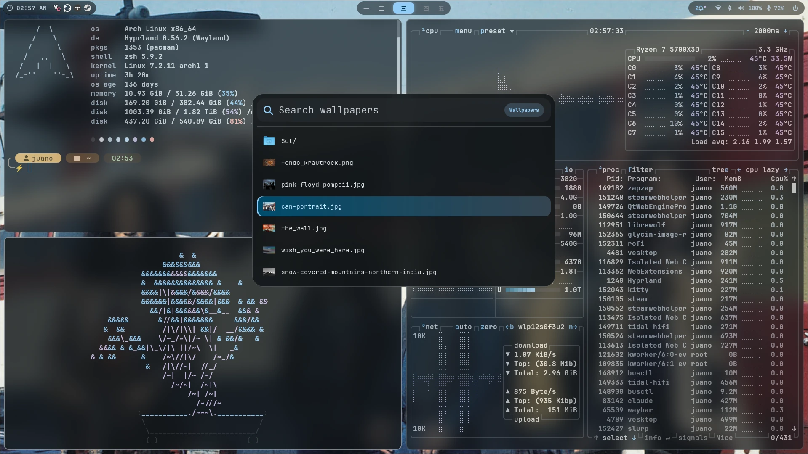
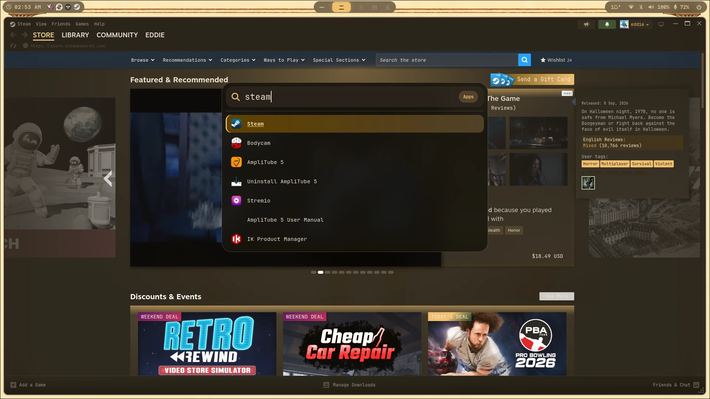

# PC Config Files

Mi customización de Arch Linux + Hyprland, lista para clonar en otra PC.

**Idea central:** todo el sistema toma su paleta del fondo de pantalla. `SUPER+W` elige un wallpaper,
[matugen](https://github.com/InioX/matugen) genera una paleta Material You a partir de él y la escribe en
los temas de ~25 apps; después `theme-reload.sh` recarga en vivo lo que puede y reinicia (en su mismo
workspace) lo que no.





<sub>Mismo sistema con dos fondos distintos: al elegir un wallpaper con <code>SUPER+W</code>, todo (barra, bordes, terminal, rofi, GTK, Steam, YouTube...) toma su paleta.</sub>

> **Instalar, aplicar, usar y desinstalar:** ver [`instructions.md`](instructions.md). Está escrito para
> leerse aparte, y para que un agente (Claude Code) lo pueda seguir paso a paso.

---

## Índice
1. [Qué contiene el repo](#qué-contiene-el-repo)
2. [Aplicaciones](#aplicaciones)
3. [Tema dinámico (matugen)](#tema-dinámico-matugen)
4. [Hyprland](#hyprland)
5. [Barra, launcher, notificaciones y menús](#barra-launcher-notificaciones-y-menús)
6. [Apps con tema propio](#apps-con-tema-propio)
7. [Cursor, GTK, fuentes y shell](#cursor-gtk-fuentes-y-shell)
8. [Autoscroll con el mouse](#autoscroll-con-el-mouse)
9. [tidal-hifi: navegación con flechas](#tidal-hifi-navegación-con-flechas)
10. [Atajos de teclado](#atajos-de-teclado)
11. [Scripts del repo](#scripts-del-repo)

---

## Qué contiene el repo
| Carpeta | Va a |
|---|---|
| `config/<x>` | `~/.config/<x>`: hypr, waybar, rofi, kitty, cava, fastfetch, gtk-3.0/4.0, swaync, wlogout, matugen, spicetify, btop, bonsai, neofetch, autostart, nvim, ghostty, ohmyposh, colors, fontconfig, viegphunt, steam-theme, millennium, ZapZap, `vesktop/{themes,settings}`, `tidal-hifi/{themes,userscripts}`, `nvim-kickstart` + archivos sueltos (`mimeapps.list`, `xdg-terminals.list`, `starship.toml`, `qalculate/qalculate-gtk.cfg`, `Code/User/settings.json`, `systemd/user/autoscroll.service`, ...) |
| `home/` | dotfiles de la home (`.bashrc`, `.bash_profile`, `.zshrc`, `.zshenv`, `.nanorc`, `.tmux.conf`, `.gitconfig`, ...), `.tmux/`, `.fonts/`, `.icons/` y `Pictures/Wallpapers` (sueltos + `Set/`) |
| `extra/` | temas que viven fuera de `~/.config`: ZapZap, `userChrome/userContent.css` de LibreWolf, extensión de VS Code `local.matugen-theme`, tema `matugen` de Millennium (Steam), tema de PrismLauncher, temas GTK `Matugen-a/b`, cursor `Matu` (`~/.local/share/icons`), `bin/wivrn-dashboard-avahi` y `bin/librewolf` (`~/.local/bin`), `applications/` (`librewolf.desktop` y `nemo.desktop`, en `~/.local/share/applications`), `dconf-interface.ini` (tema GTK, íconos, cursor, fuentes) y `system/` (archivos fuera de `~`: regla udev del autoscroll; patcher del `app.asar` de tidal-hifi + hook de pacman) |
| `packages/` | `deps.txt` (a mano: lo que usan las configs y scripts del repo), `pacman.txt` / `aur.txt` (volcado de la PC de origen que regenera `update.sh`) |
| `install.sh` · `update.sh` · `revert.sh` · `lib.sh` | instalar en una máquina · copiar esta máquina al repo · deshacer una instalación · listas compartidas (qué se sincroniza) |

Varios `~/.config/<x>` (nvim, ghostty, ohmyposh, colors, fontconfig, viegphunt) y `.zshrc`, `.tmux.conf`, `.tmux`
son symlinks a `~/dotfiles` en esta PC; acá se guarda el **contenido real** (`tar -h` / `cp -L`).

Archivos propios de cada máquina que **no** viajan (`LOCAL_FILES` en `lib.sh`): `~/.config/hypr/monitors.lua`
(resolución, posición, scale), `~/.config/waybar/config` (qué barras hay en cada monitor y qué workspaces muestran)
y `~/.config/rofi/power-menu.sh` (solo en la laptop: menú de modos de energía de `power-profiles-daemon`, que se
abre con click en la batería de waybar; el tiempo restante pasa al click derecho).
`update.sh` no los sube e `install.sh` no los pisa si ya existen; si faltan, `install.sh` genera `monitors.lua` y
copia el `config` del repo (default: variante `bintang default`, la de la PC). Tampoco viaja el symlink
`~/.config/hypr/current_wallpaper` (lo crean `install.sh` y el selector de fondos).

---

## Aplicaciones
Todo lo de esta tabla está instalado en esta PC; los paquetes exactos están en `packages/`.

| Rol | App | Config en el repo |
|---|---|---|
| Compositor / WM | [Hyprland](https://hypr.land) (config en **Lua**) | `config/hypr` |
| Barra | Waybar (estilo "bintang") | `config/waybar` |
| Launcher | Rofi estilo Spotlight (`SUPER+R`) + selector de emojis (`SUPER+I`) + menú de wifi propio | `config/rofi` |
| Notificaciones | SwayNC | `config/swaync` |
| Menú de apagado | wlogout (íconos teñidos con la paleta) | `config/wlogout` |
| Lockscreen / idle | hyprlock, hypridle | `config/hypr` |
| Fondo de pantalla | awww (`awww-daemon`); `SUPER+W` abre un selector en rofi con carpetas | `config/hypr`, `home/Pictures/Wallpapers` |
| Paleta de colores | matugen | `config/matugen` |
| Terminal | Kitty (Ghostty configurado) | `config/kitty`, `config/ghostty` |
| Shell | zsh (zinit, fzf, zoxide, oh-my-posh), bash | `home/.zshrc`, `home/.zshenv`, `config/ohmyposh`, `home/.bashrc` |
| Multiplexor | tmux + tpm | `home/.tmux.conf`, `home/.tmux` |
| File manager | Nemo (default) · Yazi en terminal (`SUPER+SHIFT+E`) · Nautilus de respaldo | `config/gtk-3.0/gtk.css`, `config/mimeapps.list`, `extra/applications/nemo.desktop` |
| Navegadores | LibreWolf (con `userChrome`/`userContent` propios), Google Chrome | `extra/librewolf-chrome` |
| YouTube | Enhancer for YouTube (extensión de LibreWolf) con CSS y paleta de matugen | `config/matugen/templates/youtube-enhancer*` |
| Mensajería | ZapZap (WhatsApp) | `extra/zapzap` |
| Música | tidal-hifi | `config/tidal-hifi/themes` |
| Editor | VS Code (tema matugen), Neovim (+ kickstart con `vk`), nano | `extra/vscode-matugen-theme`, `config/Code/User/settings.json`, `config/nvim`, `config/nvim-kickstart`, `home/.nanorc` |
| Steam | Millennium con tema `matugen` | `config/steam-theme`, `config/millennium`, `extra/steam-millennium-theme` |
| Minecraft | PrismLauncher (tema matugen) | `extra/prismlauncher-theme` |
| Calculadora | Qalculate (colores de matugen) | `config/qalculate/qalculate-gtk.cfg` |
| Monitor / info | btop, fastfetch, cava | `config/btop`, `config/fastfetch`, `config/cava` |
| Audio | PipeWire + WirePlumber, pavucontrol (`SUPER+K`), pamixer, playerctl | `config/pavucontrol.ini` |
| Brillo / energía | brightnessctl, power-profiles-daemon | — |
| Red / Bluetooth | NetworkManager (nm-applet, `nmcli`), BlueZ + Blueman | — |
| Capturas / portapapeles | grim + slurp (`SUPER+P`), wl-clipboard + cliphist (`SUPER+V`), hyprpicker (`SUPER+SHIFT+C`) | `config/hypr/scripts` |
| Polkit / portal | hyprpolkitagent, xdg-desktop-portal-hyprland | — |
| Impresión | CUPS, system-config-printer | — |
| Fuentes | JetBrainsMono Nerd Font, Noto (+CJK, emoji), DejaVu, Liberation | `home/.fonts`, `config/fontconfig` |
| Paquetes | pacman, yay, GNU Stow | `config/yay` |
| Git | git, GitHub CLI (`gh`) | `home/.gitconfig` |

**Con tema pero sin instalar en esta PC:** Vesktop (`config/vesktop`) y Spicetify (`config/spicetify`).
Matugen les genera el tema, pero no figuran en `packages/`; instalalas aparte si las querés.

---

## Tema dinámico (matugen)

### Flujo al cambiar el fondo (`SUPER+W`)
1. `hypr/scripts/wppicker.sh` abre rofi sobre `~/Pictures/Wallpapers`: primero las subcarpetas (`Set/`), después
   las imágenes sueltas (las más nuevas primero); `..` vuelve atrás.
2. `matugen image --source-color-index 0 <imagen>` pone el fondo (vía awww, con transición) y renderiza todos los
   templates de `config/matugen/templates/` según `config/matugen/config.toml`.
3. Los `post_hook` de matugen recargan lo instantáneo: waybar (SIGUSR2), kitty (SIGUSR1), cava, cursor `Matu`
   (`build.py --apply`), prompt de oh-my-posh, colores de Qalculate y tema de Steam (`steam-theme/build.sh`).
4. `matugen/scripts/theme-reload.sh` (en segundo plano) hace el resto (log en `$XDG_RUNTIME_DIR/theme-reload.log`):
   - **En vivo:** GTK3 (alterna el tema `Matugen-a` ↔ `Matugen-b` para que nemo/waybar relean los colores), btop
     (SIGUSR2), swaync (`swaync-client -rs`), íconos de wlogout (`tint-icons.sh`). VS Code y Vesktop vigilan sus
     archivos solos.
   - **Reinicio automático**, vuelven a su workspace: ZapZap y Qalculate.
   - **Reinicio "inteligente":** tidal-hifi se reinicia solo si no está reproduciendo; Steam solo si no hay un juego
     abierto. Si no, se pregunta.
   - **Preguntan:** LibreWolf y PrismLauncher, con un popup único "Reiniciar todo / Ignorar" y una notificación por app
     que queda en el panel de swaync.
   - **Steam:** la ventana la crea `steamwebhelper` (otro PID) y, después del login, Steam la vuelve a mapear en el
     workspace con foco. El script la vigila hasta 2 min y la devuelve a su workspace.
   - **YouTube (Enhancer):** su CSS vive en la base IndexedDB de la extensión, así que se escribe con LibreWolf cerrado
     (justo antes de relanzarlo, o en el momento si ya estaba cerrado). Si se eligió "Ignorar", el wrapper
     `~/.local/bin/librewolf` (lo usan `SUPER+B` y `librewolf.desktop`) lo aplica la próxima vez que se abra LibreWolf.
5. Se actualiza `~/.config/hypr/current_wallpaper`, que es el fondo que se carga al iniciar sesión.

### Templates (`config/matugen/templates` → destino)
| Template | Genera | Recarga |
|---|---|---|
| `colors.css` | `~/.config/waybar/colors.css` (también lo importan swaync y wlogout) | SIGUSR2 a waybar |
| `kitty-colors.conf` | `~/.config/kitty/colors.conf` | SIGUSR1 a kitty |
| `hyprland-colors.conf` / `.lua` | `~/.config/hypr/colors.conf` (hyprlock) / `colors.lua` (bordes, etc.) | hyprctl reload |
| `gtk-colors.css` | `~/.config/gtk-3.0/colors.css`, `~/.config/gtk-4.0/colors.css` | toggle Matugen-a/b (GTK3); GTK4 al reiniciar la app |
| `rofi-colors.rasi` | `~/.config/rofi/colors.rasi` (incluye el gradiente y colores "glass") | próxima apertura |
| `matugen-cava` | `~/.config/cava/config` | SIGUSR1 |
| `spotify-colors.ini` | `~/.config/spicetify/Themes/text/color.ini` | — |
| `midnight-discord.css` | `~/.config/vesktop/themes/matugen.css` | Vesktop vigila el archivo |
| `firefox-userChrome.css` / `firefox-userContent.css` | `<perfil LibreWolf>/chrome/` | reinicio de LibreWolf |
| `youtube-enhancer.css` / `youtube-enhancer-colors.json` | `~/.config/youtube-enhancer/` → storage de Enhancer for YouTube | reinicio de LibreWolf |
| `zapzap.css` | `~/.local/share/ZapZap/customizations/global/css/matugen.css` | reinicio automático |
| `tidal-hifi.css` | `~/.config/tidal-hifi/themes/matugen.css` | reinicio (si no suena música) |
| `btop.theme` | `~/.config/btop/themes/matugen.theme` | SIGUSR2 |
| `vscode-theme.json` | extensión `local.matugen-theme` | en vivo (`_watch`) |
| `qalculate-colors.sh` | script que reescribe `qalculate-gtk.cfg` | reinicio automático |
| `steam-millennium.css` | `~/.config/steam-theme/colors.css` → `build.sh` arma el tema Millennium | reinicio (si no hay juego) |
| `prismlauncher-theme.json` / `-style.css` | `~/.local/share/PrismLauncher/themes/matugen/` | reinicio |
| `cursor-colors.json` | `~/.config/hypr/scripts/cursor/colors.json` → cursor `Matu` | `hyprctl setcursor` |
| `ohmyposh-palette.json` | `~/.config/ohmyposh/matugen-palette.json` → `matugen.omp.json` | próximo prompt |

---

## Hyprland
- Config en **Lua**: `config/hypr/hyprland.lua` carga `configs/{tags,looknfeel,animations,opacity,windowrules,input,keybinds}.lua`
  y `monitors.lua` (propio de cada máquina, opcional).
- `hyprctl dispatch` usa sintaxis Lua: `hyprctl dispatch 'hl.dsp.focus({ workspace = "3" })'`.
- Autostart (`hl.on("hyprland.start")`): waybar, awww-daemon + fondo actual, swaync, hyprpolkitagent, hypridle,
  indicador de autoscroll, cliphist (texto e imágenes). El servicio `autoscroll.service` arranca por systemd.
- **Window rules:** el diálogo de Bitwarden de LibreWolf y la app Bitwarden flotan centrados en vertical; Proton
  Authenticator flota; en Steam flota todo menos la ventana principal ("Steam"), y la lista de amigos es angosta.
  Se ignoran los pedidos de maximizar de las apps.
- **Workspaces especiales** (scratchpads): "magic" con `SUPER+S` y "claude" (para Claude Code) con `SUPER+Z`;
  `SUPER+SHIFT+S` / `SUPER+SHIFT+Z` mandan la ventana ahí recordando su workspace de origen, y si ya está ahí la
  devuelven (`scripts/special-move.sh [nombre]`). En la waybar: burbuja 智 a la izquierda de los workspaces
  (claude) o 特 a la derecha (magic); con un especial abierto la isla se vuelve más translúcida y sube el blur.
- **Animaciones:** popin para rofi y el menú de música, fade (ease-out al entrar, ease-in al salir) para las capas
  que cubren la pantalla: pronóstico del clima, panel de swaync, wlogout (`configs/animations.lua` + `layer_rule`s en
  `configs/windowrules.lua`).
- **Opacidad sin foco por app:** tres niveles en `configs/opacity.lua` (`transparency_dif_low/mid/high` = 0.65 / 0.75 /
  0.85, con `override`: es el valor final). Default `mid`; `high` para kitty, LibreWolf, Vesktop, editores y
  pavucontrol; `low` para tidal-hifi y ZapZap. Se asignan en `configs/windowrules.lua` con `inactive_opacity_rule()`.
- **Blur con un especial abierto:** mientras se ve un workspace especial, el blur pasa de 5×3 a 10×4
  (`configs/looknfeel.lua`, evento `workspace.special_active`). `blur.special` queda en `false`: en `true` tapa la waybar.
- **hypridle:** baja el brillo a los 2,5 min (el bloqueo, el apagado de pantalla y la suspensión están comentados).
- `SUPER+O` (`reload-all.sh`) recarga Hyprland y reinicia swaync y waybar.

## Barra, launcher, notificaciones y menús
- **Waybar** (`config/waybar`): `config` y `style.css` apuntan a la variante elegida en `configs/` y `style/`
  (actual: "bintang default"; `SUPER+CTRL+B` / `SUPER+ALT+B` cambian estilo y layout).
  - Isla de workspaces por monitor con animaciones (el foco crece a una píldora con glow; urgente parpadea en
    `@tertiary`), burbujas de los workspaces especiales a los costados (智 claude a la izquierda / 特 magic a la derecha) con un halo en
    `@secondary` que respira y glow `@primary` al pasar el mouse. Con un especial abierto en ese monitor la isla se
    vuelve más translúcida y el foco pasa a un tinte suave (`custom/special-flag`: módulo de ancho cero que corre la
    isla a `:nth-child(3)`). Al pasar el mouse, cada workspace se enmarca en un cuadradito redondeado (borde fino +
    fondo leve en `@primary`) sin mover la isla. `scripts/ws-listener.py` sigue los eventos de Hyprland (tolera los
    especiales sin `id` de Hyprland 0.57 y se reconecta si falla).
  - Volumen propio (`scripts/volume.py`, con `pactl subscribe`): las ondas del parlante se animan al pasar el mouse.
  - Indicador de idioma del teclado (`hyprland/language#kb` en `UserModules`): muestra `󰌌 US` / `󰌌 LA`, se
    actualiza solo con `SUPER+Space` y al hacer click cambia de idioma (mismo `SwitchLayout.sh`, con notificación).
    Va en `modules-right` de `config`, que es local por máquina: en la laptop hay que agregarlo a mano.
  - **Música** (`custom/music`, `scripts/music*.{py,sh}`): un ícono 󰝚 que **solo** sigue a tidal-hifi y DeaDBeeF
    (MPRIS con lista blanca vía libplayerctl; ignora navegadores, ZapZap y el `chromium.instanceN` de Electron).
    Color del tema mientras suena, apagado en pausa. Click = mini menú (`music-popup.py`, GTK3 + layer-shell):
    carátula, título/artista/álbum, barra de progreso (click/arrastre para saltar), anterior/pausa/siguiente,
    botón para alternar reproductor y slider de volumen (el mismo que la rueda; con la rueda encima usa los mismos pasos); se cierra al alejar el mouse o con otro click.
    A la derecha (opuesto al nombre del reproductor) el botón de **salida de audio** (󰓃/󰍹/󰋋 según el tipo):
    despliega las salidas y la elegida pasa a ser la de por defecto, moviendo lo que ya suena (`pactl`). Click derecho = pausa/play,
    medio = cambiar de reproductor, rueda = volumen **del reproductor** (MPRIS, no el del sistema;
    pasos de 1 % hasta 10, 2 % hasta 30 y 5 % después; el tooltip muestra el nivel; en tidal-hifi el slider
    lo sigue gracias a `userscripts/volume-sync.js`, ver abajo). Muestra el último que empezó a sonar.
    El menú abierto recarga sus colores en vivo si cambia `colors.css` (Super+W).
    En esta PC hay uno por barra (`custom/music#dp3` / `#hdmi`, el argumento resalta solo el ícono del monitor
    con el menú abierto); en otra máquina agregá `"custom/music"` al principio de `modules-right` de `config`.
    Usa `playerctl`, `gtk-layer-shell` (dependencias de waybar) y `python-gobject`.
  - **Reloj:** click derecho = calendario (`scripts/calendar-popup.py`, GTK3 + layer-shell) que baja desde la
    esquina, debajo de la hora: mes con números de semana ISO (la semana empieza según el locale), hoy resaltado en
    `@primary`; `‹ ›` / `← →` / rueda cambian de mes (con deslizamiento), `« »` / `↑ ↓` de año, y tocando el mes
    o el año se abre una grilla para elegirlos (`m` / `y`); `Home` / "Today" vuelve a hoy. Se cierra con `Esc`,
    click afuera o alejando el mouse. La hora no tiene tooltip (click izquierdo alterna hora / fecha completa).
  - **Clima** (`custom/weather#ba`, `scripts/weather*.py`): a la derecha del reloj, ícono según el tiempo +
    temperatura actual de la ciudad elegida ([Open-Meteo](https://open-meteo.com), sin API key, cada 15 min; sin red
    muestra el último valor guardado, atenuado). Tooltip con condición, sensación térmica, mín/máx, humedad y viento.
    - **Click** = pronóstico (`weather-popup.py`, GTK3 + layer-shell, baja desde la esquina debajo de la barra): curva de
      temperatura hora por hora de 00 a 00 (sensación térmica punteada, noche sombreada, marca de "ahora", detalle de
      cada hora al pasar el mouse), tira cada 3 h con lluvia y fila de **7 días** (click, `←/→`, `1-7` o rueda).
      Usa la zona horaria de la ciudad. `R` actualiza, `S` / 󰍉 cambia de ciudad y vuelve al pronóstico. Se cierra
      con `Esc`, click afuera, otro click o alejando el mouse. Sin layer-shell (o con `--html`) abre lo mismo como página en el
      navegador (`~/.cache/waybar-weather/today.html`).
    - **Click derecho** = buscar ciudad (`weather-search.py`, estilo spotlight, también en la esquina): resultados mientras escribís
      (geocoding de Open-Meteo) con bandera, provincia/país y hora local para distinguir homónimas; vacío muestra las
      **recientes** (✓ en la actual). `↑/↓`, `Enter`, `Esc`. Sin layer-shell usa `rofi -dmenu`.
    - La ciudad elegida y las recientes se guardan en `~/.local/state/waybar-weather/location.json`, **fuera** de
      `~/.config` a propósito: no se sube al repo y cada máquina tiene la suya. Sin ese archivo: Buenos Aires.
    - Va en `modules-left` de `config` (local: en otra máquina agregalo después de `"clock"`).
  - Campana de swaync que suena una vez con cada notificación nueva; batería que "respira" cargando y titila crítica;
    botón de apagado con glow en `@primary`. Micro-animaciones de hover (una vez): la nota de música salta, la
    tecla del idioma se hunde y el wifi emite dos ondas de brillo.
  - **Una ventana de la barra a la vez:** `scripts/popups.sh close-except <x>` cierra las demás (menú de música,
    clima, buscador, calendario, panel de swaync, menú wifi, wlogout). `scripts/popups-daemon.py` (`custom/popups-daemon`, lo
    lanza waybar) cierra el resto cuando se abre el panel de swaync —aunque sea con un atajo— y lo cierra si el
    mouse se aleja 0,7 s (solo después de haber pasado por encima). Click afuera lo cierra el propio swaync.
    En otra máquina agregá `"custom/popups-daemon"` (y `custom/special-flag#…` si usás las burbujas) a `config`.
  - Todos los colores salen de `colors.css` (matugen): `@error` solo para alertas críticas (batería, temperatura);
    el volumen muteado se apaga con `@outline` como la música en pausa.
  - En esta PC `style.css` es un **hardlink** a `style/bintang default.css`: editalo en el lugar, no lo reemplaces.
- **Rofi** (`config/rofi/config.rasi`): estilo Spotlight compartido por todos los menús. Solo el launcher agrega
  `require-input` (la lista aparece al escribir). `wifi-menu.sh` es un menú de redes propio.
  - **Selector de emojis** (`SUPER+I`, `scripts/emoji-picker.sh` + `emoji.rasi`): mismo estilo y colores, grilla de
    9 columnas y una fila de categorías bajo la búsqueda (click, `Ctrl+Tab` o `Shift+←/→`). Cada categoría es un modo
    script de rofi (`scripts/emoji.sh`) que lee la lista de `rofi-emoji`; busca por nombre/palabras clave en inglés y
    Enter copia el emoji (`wl-copy`).
- **SwayNC** (`config/swaync`): colores de waybar, popups de 390 px con fondo al 96 %; el panel se agranda o achica con las flechas
  ◂▸▴▾ (`scripts/resize.sh`). Reglas: las notificaciones `theme.summary` solo se ven como popup, las `theme.app`
  van directo al panel. Sin el reproductor MPRIS genérico: la música se controla con el ícono 󰝚 de waybar.
  Fila de arriba (`menubar#top`): título + luna 󰽥 (Do Not Disturb, se resalta encendida) y vaciar 󰎟.
- **wlogout**: íconos PNG re-teñidos con el primary en cada cambio de fondo (`tint-icons.sh` → `icons/matugen/`).
- **hyprlock**: colores de `hypr/colors.conf`.

## Apps con tema propio
- **LibreWolf:** `userChrome.css` (barra, pestañas, paneles) y `userContent.css` (about:home, about:newtab, páginas
  internas, scrollbars finas). `install.sh` los copia al perfil activo y reescribe las rutas en `matugen/config.toml`.
- **YouTube (Enhancer for YouTube):** tema base "DeepDark custom" con la paleta del fondo + CSS propio: barra superior
  translúcida con blur, buscador y chips como píldoras, miniaturas redondeadas que se levantan con glow, menú lateral
  con el activo en `secondary_container`, botones y barra de progreso en `primary`, menús del reproductor translúcidos.
  `youtube-enhancer-apply.sh` lo escribe en el `storage.local` de la extensión con `moz_ext_storage.py` (codec de
  IndexedDB de Firefox en Python puro). No edites el CSS desde la página de la extensión: se pisa en cada cambio de fondo.
- **Steam (Millennium):** `steam-theme/generate.py` extrae las reglas de color del CSS de Steam y las re-emite como
  `var(--m-*)`; `build.sh` arma `client.css`/`webkit.css` del tema `matugen`. Se inyecta solo en las ventanas
  principales (no en el login) para que Steam arranque rápido. Tras una actualización de Steam: `build.sh --regen`.
- **Vesktop:** paleta de matugen sobre el layout de midnight-discord (`themes/lib/midnight-fixed.css` tiene los nombres
  de clase nuevos de Discord).
- **tidal-hifi, ZapZap, PrismLauncher, VS Code, btop, cava, Qalculate, kitty, Spicetify:** ver la tabla de templates.

## Cursor, GTK, fuentes y shell
- **Cursor `Matu`:** generado por `hypr/scripts/cursor/build.py` (formas redondeadas, cuerpo oscuro, acentos en
  primary) en `~/.local/share/icons/Matu`, en XCursor y hyprcursor. Se rehace en cada cambio de fondo.
  `build.py --preview out.png` muestra una hoja de contactos.
- **GTK:** temas `Matugen-a`/`Matugen-b` = adw-gtk3-dark + `colors.css`. GTK4/libadwaita importa
  `gtk-4.0/colors.css`. Tema, íconos, cursor y fuentes en dconf (`extra/dconf-interface.ini`).
- **Fuentes:** JetBrainsMono Nerd Font (terminal y barra), Noto, `home/.fonts`.
- **zsh + oh-my-posh:** el diseño del prompt (segmentos tipo píldora) está en `config/ohmyposh/viet.omp.json`;
  `ohmyposh-build.py` le inyecta la paleta → `matugen.omp.json`, que carga `.zshrc`.

## Autoscroll con el mouse
`hypr/scripts/autoscroll.py` (python-evdev, servicio `autoscroll.service`) toma los mouse y los re-emite por un
dispositivo virtual. **Clic medio normal = clic medio; `Super` + clic medio = autoscroll** (un toque lo fija y
mover el mouse desplaza; mantener y arrastrar desplaza mientras se mantiene; cualquier clic sale). Un indicador
GTK4 layer-shell muestra la burbuja. Los mouse se acceden con la regla udev `70-mouse-uaccess.rules`
(sin meter al usuario en el grupo `input`). No lee el teclado: un bind `SUPER + mouse:274` de Hyprland consume el
clic y le avisa al daemon, así que no hay estado de "Super apretado" que pueda quedar trabado.
Si el mouse se porta raro, este daemon es el primer sospechoso: `journalctl --user -u autoscroll`.

## tidal-hifi: navegación con flechas
tidal-hifi no permite JS propio, así que `patch-asar.py` (Python puro, sin node) le agrega al final de
`ts-dist/main.js` dentro de `/opt/tidal-hifi/resources/app.asar` un cargador chico: en cada carga de la página de
TIDAL ejecuta todos los `~/.config/tidal-hifi/userscripts/*.js`. El patch es idempotente (marca
`tidal-hifi-userscripts-loader`) y el hook `/etc/pacman.d/hooks/tidal-hifi-userscripts.hook` lo vuelve a aplicar
cuando se actualiza `tidal-hifi-bin`. (Hace falta tocar el asar: en apps empaquetadas Electron ignora
`NODE_OPTIONS=--require`.) Los fuentes y un `install.sh` están en `config/tidal-hifi/userscripts/install/`.

`userscripts/arrow-nav.js` es una navegación espacial propia (la de Chromium, `--enable-spatial-navigation`, se
trababa en el buscador):
- **↑/↓/←/→** mueven un resaltado (contorno con el color del tema) entre botones, links, tarjetas y temas; la página
  scrollea con él y nunca lo deja tapado por la barra del reproductor. Cada fila de tema y cada tarjeta
  (álbum/playlist/atajo de la home) es una sola parada. Subiendo en un álbum se llega a Play/Shuffle/artista.
- Si no hay nada enfocable en esa dirección, ↑/↓ scrollean la página. ←/→ siguen en la misma línea; desde el
  borde saltan entre el sidebar y el contenido.
- **Ctrl+↑ / Ctrl+↓**: primer / último tema de la lista. Las playlists largas se cargan de a ~20 filas, así que
  Ctrl+↓ sigue bajando hasta que aparece la última (≈2 s para 519 temas). En páginas sin lista de temas Ctrl+↑/↓
  sigue siendo el volumen de tidal-hifi.
- **Enter** en un tema lo reproduce (en tarjetas/links los abre); **Esc** o un clic sacan el resaltado.
- No interfiere al escribir (buscador), en menús contextuales ni con ←/→ sobre las barras de volumen/progreso.

Editar el script no requiere reiniciar: `Ctrl+U` (hard reload de tidal-hifi) lo vuelve a cargar.

`userscripts/volume-sync.js`: tidal-hifi aplica el volumen que llega por MPRIS (la rueda sobre el ícono de música de
waybar), su API o sus atajos directo al `<audio>`, a espaldas de TIDAL: el slider no se movía y TIDAL volvía a poner
su valor. El script escucha `volumechange` y pasa esos cambios al store Redux de TIDAL
(`playbackControls/SET_VOLUME`), así TIDAL los aplica como si movieras su slider. Ignora sus propios cambios, el
elemento en pausa y saltos de más de 25 % (nunca sube de golpe al 100 %).

---

## Atajos de teclado
`SUPER` = tecla Windows. Definidos en `config/hypr/configs/keybinds.lua`.

| Atajo | Acción |
|---|---|
| `SUPER+T` / `SUPER+Enter` | terminal (kitty) / terminal flotante |
| `SUPER+R` | launcher (rofi) |
| `SUPER+E` / `SUPER+SHIFT+E` | Nemo / Yazi |
| `SUPER+B` / `SUPER+N` | LibreWolf / Google Chrome |
| `SUPER+W` | **elegir wallpaper → retematiza todo el sistema** |
| `SUPER+C` | cerrar ventana |
| `SUPER+SHIFT+Q` | matar el proceso de la ventana activa |
| `SUPER+F` / `SUPER+SHIFT+V` | pantalla completa / alternar flotante |
| `SUPER+J` | cambiar orientación del split (dwindle) |
| `SUPER+1..0` / `SUPER+SHIFT+1..0` | ir a workspace / mover ventana a workspace |
| `SUPER+←/→` / `SUPER+SHIFT+←/→` | workspace anterior/siguiente / mover ventana ahí |
| `SUPER+↑/↓` | foco arriba/abajo |
| `SUPER+CTRL+flechas` / `SUPER+ALT+flechas` | mover ventana / redimensionar |
| `SUPER+rueda` | recorrer workspaces |
| `SUPER+clic izq.` / `SUPER+clic der.` | arrastrar / redimensionar ventana |
| `SUPER+S` / `SUPER+SHIFT+S` | mostrar workspace especial "magic" / mandar o devolver ventana |
| `SUPER+Z` / `SUPER+SHIFT+Z` | mostrar workspace especial "claude" (Claude Code) / mandar o devolver ventana |
| `SUPER+V` | historial del portapapeles |
| `SUPER+I` | selector de emojis (Enter copia) |
| `SUPER+P` | captura de región (se guarda en `~/Pictures/Screenshots` y se copia) |
| `SUPER+SHIFT+C` | selector de color (hyprpicker) |
| `SUPER+Espacio` | alternar teclado us / latam |
| `SUPER+K` | pavucontrol |
| `SUPER+M` | mutear micrófono |
| `SUPER+L` | bloquear pantalla |
| `SUPER+H` | ocultar/mostrar waybar |
| `SUPER+O` | recargar Hyprland + swaync + waybar |
| `SUPER+SHIFT+R` | reiniciar waybar (script viejo) |
| `SUPER+CTRL+B` / `SUPER+ALT+B` | menú de estilos / layouts de waybar |
| `CTRL+ALT+Supr` | salir de Hyprland |
| Teclas multimedia | volumen, mic, brillo y reproducción (funcionan con la pantalla bloqueada) |
| `Super` + clic medio | autoscroll |
| tidal-hifi: `↑/↓/←/→` · `Enter` · `Esc` | mover el resaltado · reproducir/abrir · soltar |
| tidal-hifi: `Ctrl+↑/↓` | primer / último tema de la lista (sin lista: volumen) |

---

## Scripts del repo
```bash
./install.sh -n     # solo revisión: qué es nuevo / cambia / igual + diff de binds de hypr
./install.sh        # revisa, pide confirmación, respalda en backups/<fecha>/ e instala
./install.sh -p     # igual + yay si falta + packages/deps.txt (+ opcional todo pacman.txt/aur.txt) + servicios
./update.sh [-n] [-p]   # copia esta máquina al repo (-p: commit "Sync <fecha>" + push)
./revert.sh -l | [fecha] # lista backups / deshace una instalación
```
`update.sh` no sube el historial de qalculate ni el del diálogo de archivos de Qt (`QtProject.conf`), porque el repo es
público. Qué se sincroniza se define en los arrays de `lib.sh` (`CONFIG_DIRS`, `CONFIG_FILES`, `HOME_FILES`, `HOME_DIRS`,
`EXTRA_FILES`, `EXTRA_DIRS`, `SYSTEM_FILES`). Detalle completo en [`instructions.md`](instructions.md).
